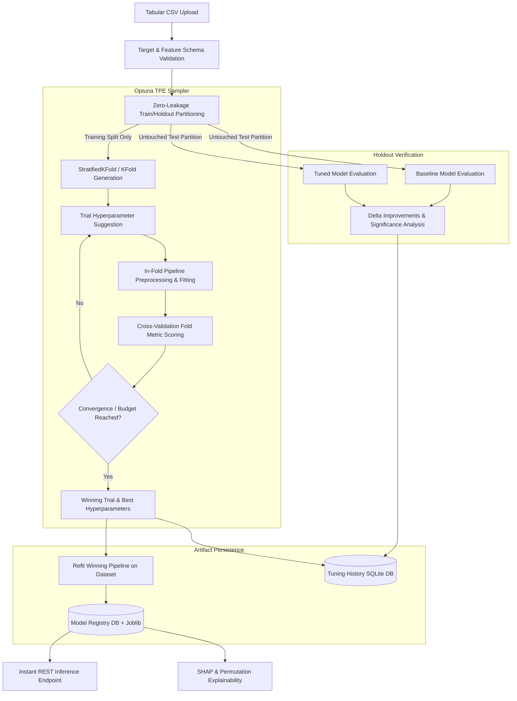

# AutoVeyra — Hyperparameter Optimization Engine Technical Design

**Document Version:** 1.0  
**Phase:** Phase 3 — Production-Grade Hyperparameter Optimization Engine  
**Author:** ML Engineering & Systems Architecture  
**Status:** Approved & Implemented  

---

## 1. Architectural Overview

AutoVeyra's Hyperparameter Optimization Engine provides automated, Bayesian-guided tuning for tabular supervised machine learning models. Built upon Optuna's Tree-structured Parzen Estimator (`TPESampler`), the engine optimizes candidate models over structured search spaces while enforcing strict zero-leakage cross-validation boundaries and unbiased holdout validation.

Winning pipelines are refitted and automatically registered in the AutoVeyra Model Artifact Registry (`server/data/model_registry.db` + `.joblib`), enabling instant downstream inference (`/models/{id}/predict`) and model explainability (`/models/{id}/explainability/*`).



---

## 2. Search Spaces & Estimator Architecture

The engine supports 6 tunable tabular estimator architectures across classification and regression. Ordinary Least Squares (`LinearRegression`) does not possess tunable hyperparameters; attempts to tune it return clean diagnostics directing users toward tree-based regressors.

### 2.1. Classification Search Spaces

| Estimator | Parameter | Type | Distribution / Choices | Default Baseline |
| :--- | :--- | :--- | :--- | :--- |
| **`LogisticRegression`** | `C` | Float | Log-uniform: `[1e-4, 100.0]` | `1.0` |
| | `max_iter` | Categorical | `[500, 1000, 2000]` | `1000` |
| | `solver` | Fixed | `lbfgs` (with `class_weight='balanced'`) | `lbfgs` |
| **`DecisionTreeClassifier`** | `criterion` | Categorical | `['gini', 'entropy', 'log_loss']` | `'gini'` |
| | `max_depth` | Integer | Uniform: `[2, 20]` | `None` (unbounded) |
| | `min_samples_split` | Integer | Uniform: `[2, 20]` | `2` |
| | `min_samples_leaf` | Integer | Uniform: `[1, 10]` | `1` |
| **`RandomForestClassifier`** | `n_estimators` | Integer | Step: `[10, 100]` (step=10) | `100` |
| | `criterion` | Categorical | `['gini', 'entropy']` | `'gini'` |
| | `max_depth` | Integer | Uniform: `[3, 15]` | `None` |
| | `min_samples_split` | Integer | Uniform: `[2, 10]` | `2` |
| | `min_samples_leaf` | Integer | Uniform: `[1, 5]` | `1` |
| | `n_jobs` | Fixed | `1` (prevents process deadlocks) | `1` |
| **`ExtraTreesClassifier`** | `n_estimators` | Integer | Step: `[10, 100]` (step=10) | `100` |
| | `criterion` | Categorical | `['gini', 'entropy']` | `'gini'` |
| | `max_depth` | Integer | Uniform: `[3, 15]` | `None` |
| | `min_samples_split` | Integer | Uniform: `[2, 10]` | `2` |
| | `min_samples_leaf` | Integer | Uniform: `[1, 5]` | `1` |
| | `n_jobs` | Fixed | `1` (prevents process deadlocks) | `1` |

### 2.2. Regression Search Spaces

| Estimator | Parameter | Type | Distribution / Choices | Default Baseline |
| :--- | :--- | :--- | :--- | :--- |
| **`DecisionTree`** | `criterion` | Categorical | `['squared_error', 'friedman_mse', 'absolute_error']` | `'squared_error'` |
| | `max_depth` | Integer | Uniform: `[2, 20]` | `None` |
| | `min_samples_split` | Integer | Uniform: `[2, 20]` | `2` |
| | `min_samples_leaf` | Integer | Uniform: `[1, 10]` | `1` |
| **`RandomForest`** | `n_estimators` | Integer | Step: `[10, 100]` (step=10) | `100` |
| | `criterion` | Categorical | `['squared_error', 'absolute_error']` | `'squared_error'` |
| | `max_depth` | Integer | Uniform: `[3, 15]` | `None` |
| | `min_samples_split` | Integer | Uniform: `[2, 10]` | `2` |
| | `min_samples_leaf` | Integer | Uniform: `[1, 5]` | `1` |
| | `n_jobs` | Fixed | `1` (prevents process deadlocks) | `1` |

---

## 3. Zero Data-Leakage Protocol

To guarantee that hyperparameter optimization does not suffer from optimistic bias or information contamination:

1. **Initial Stratified Holdout Split:**
   The raw dataset is split into `X_train, y_train` and `X_test, y_test` (default 80/20, stratified for classification). The test set `X_test, y_test` is strictly isolated and never accessed by Optuna trials, sampler suggestions, or fold transformations.

2. **Fold-Isolated Preprocessing Pipelines:**
   Inside each CV fold (`k` in `1..K`):
   - Imputation statistics (mean/median/mode) and scaling parameters (`StandardScaler`, `MinMaxScaler`, `RobustScaler`) are computed solely on `X_train_fold`.
   - `X_val_fold` is transformed using the fitted preprocessor.
   - Categorical encodings (`OneHotEncoder`) use `handle_unknown='ignore'` to safely handle previously unseen levels in validation folds.

3. **Unbiased Holdout Verification:**
   After Optuna selects the winning configuration, the baseline (default hyperparameters) and tuned models are trained on the training partition and evaluated side-by-side on the untouched holdout test partition.

---

## 4. API Endpoints

| Method | Path | Summary | Description |
| :--- | :--- | :--- | :--- |
| `POST` | `/tuning/start` | Start Optimization | Accepts multipart CSV and parameters, executes Optuna study, returns best trial, holdout deltas, and registered model ID. |
| `GET` | `/tuning` | List Tuning Runs | Returns paginated list of historical runs (`items`, `total`, `limit`, `offset`). |
| `GET` | `/tuning/{run_id}` | Get Run Details | Returns full run metrics, baseline vs tuned deltas, parameters, and trial leaderboard. |
| `GET` | `/tuning/{run_id}/trials` | Get Trials | Returns trial exploration leaderboard for a specific run. |
| `DELETE` | `/tuning/{run_id}` | Delete Tuning Run | Removes tuning run records and optionally associated registered model artifact. |
| `POST` | `/tuning/{run_id}/cancel` | Cancel Run | Safely interrupts an in-progress Optuna study. |

---

## 5. Persistence & Database Schema

Tuning records and trial metadata are stored in SQLite at `server/data/tuning_history.db`.

```sql
CREATE TABLE tuning_runs (
    id INTEGER PRIMARY KEY AUTOINCREMENT,
    run_id TEXT UNIQUE NOT NULL,
    task_type TEXT NOT NULL,
    model_type TEXT NOT NULL,
    target_column TEXT NOT NULL,
    dataset_name TEXT,
    metric TEXT NOT NULL,
    direction TEXT NOT NULL,
    n_trials INTEGER NOT NULL,
    n_splits INTEGER NOT NULL,
    status TEXT NOT NULL,
    best_trial_number INTEGER,
    best_score REAL,
    best_params_json TEXT,
    baseline_metrics_json TEXT,
    tuned_metrics_json TEXT,
    delta_metrics_json TEXT,
    registered_model_id INTEGER,
    feature_columns_json TEXT,
    data_quality_json TEXT,
    warnings_json TEXT,
    duration_seconds REAL,
    error_message TEXT,
    created_at TEXT NOT NULL
);

CREATE TABLE tuning_trials (
    id INTEGER PRIMARY KEY AUTOINCREMENT,
    run_id TEXT NOT NULL,
    trial_number INTEGER NOT NULL,
    params_json TEXT NOT NULL,
    cv_score REAL,
    duration_seconds REAL,
    state TEXT NOT NULL,
    created_at TEXT NOT NULL,
    FOREIGN KEY(run_id) REFERENCES tuning_runs(run_id) ON DELETE CASCADE
);
```
