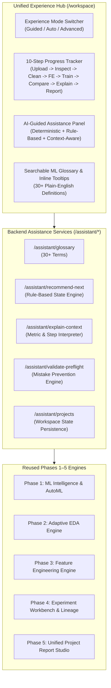

# AUTOVEYRA PHASE 6: BEGINNER-FRIENDLY AI-GUIDED MACHINE LEARNING WORKSPACE
## UX Audit, Architecture & Implementation Plan

### 1. Product Experience Audit

#### 1.1 Persona Analysis & User Friction
| Persona | Background & Expectations | Current Friction in AutoVeyra | Solved in Phase 6 |
|---|---|---|---|
| **Persona A: Complete Beginner** | Zero ML background. Wants to upload CSV, make predictions, understand conclusions, and export a report for school/work. | Confronted immediately with jargon (e.g. *One-Hot vs Label Encoding*, *RobustScaler*, *Holdout Ratio*, *F1 Macro*). Dropped onto isolated pages with no clear progression. Fear of breaking models or making wrong decisions. | **Guided Mode** (`/workspace`): 10-step progress tracker, plain-English explanations with "Why this matters", smart automated defaults, error prevention, and automated translation of technical metrics. |
| **Persona B: Intermediate User** | Understands core ML concepts (classification vs regression, accuracy vs recall), but wants rapid prototyping without clicking 50 toggles manually. | Has to manually jump across 5 different pages (`/clean`, `/features`, `/automl`, `/explain`, `/reports`) and manually re-upload or re-select artifacts. | **Auto Mode**: One-click autonomous execution with pre-flight approval, automated model benchmarking, and automatic project report generation. |
| **Persona C: Advanced ML Engineer** | Demands granular control over algorithms, custom hyperparameters, feature transformations, tuning budgets, and governance cards. | Needs full access to standalone module workbench without forced handholding or infantilizing UI simplifications. | **Advanced Mode**: Direct access to all Phase 1–5 independent modules (`/eda`, `/clean`, `/features`, `/automl`, `/tune`, `/experiments`, `/reports`). |

#### 1.2 UX Flaws Identified Across Existing Modules
1. **Navigation Overhead**: 13 links in the top navigation bar creates cognitive overload for first-time visitors; no obvious "Start Here" funnel.
2. **Missing Progression Continuity**: After uploading a dataset in `/automl`, navigating to `/eda` or `/clean` loses the context unless the user re-uploads or navigates manually through experiment records.
3. **Unexplained Technical Terminology**: Terms like *L1 Regularization*, *Multicollinearity (VIF)*, *SHAP TreeExplainer*, *Median Imputation* lack contextual tooltips or inline definitions.
4. **Opaque Metrics**: Presenting `MAE: 4.21`, `F1: 0.88`, `Log Loss: 0.32` without telling beginners whether that is good, bad, overfitted, or balanced.
5. **No Guided "What to Do Next" Engine**: Users finish training and do not realize they should run explainability, check data drift, or export a unified project report.

---

### 2. Architecture of Phase 6 Solutions

---

### 3. Core Capabilities Implemented

1. **Three Experience Modes**:
   - **Guided Mode**: Step-by-step walkthrough with sensible defaults, explanations for every choice, and guardrails against common errors.
   - **Auto Mode**: End-to-end automated pipeline execution with pre-flight summary review.
   - **Advanced Mode**: Quick access to all granular standalone tooling.
2. **10-Step Guided Project Workspace (`/workspace`)**:
   - `Step 1`: Upload Dataset (drag-and-drop, SHA-256 hashing, instant statistical preview).
   - `Step 2`: Inspect Dataset (schema, types, sample preview, row/col count).
   - `Step 3`: Understand Dataset Quality (missingness alerts, duplicate records, high cardinality).
   - `Step 4`: Select Prediction Objective (category vs numerical, target column with plain-English justification).
   - `Step 5`: Clean & Prepare Data (missing values, duplicates, outliers, scaling with accept/customize/skip).
   - `Step 6`: Engineer Features (date extraction, interactions, transformations with plain-English justification).
   - `Step 7`: Train Models (accessible overview of algorithms, progress tracking, no fake percentages).
   - `Step 8`: Compare Results (plain-English metric explanations, holdout vs CV generalization gap).
   - `Step 9`: Explain Model Predictions (SHAP & Permutation importance, correlation vs causation clarity).
   - `Step 10`: Generate Final Project Report (multi-format PDF/HTML/JSON/ZIP with verified dataset inclusion).
3. **Rule-Based Next-Action Recommendation Engine**:
   - Evaluates active dataset, runs, tasks, and completed stages to dynamically suggest the optimal next action.
4. **Searchable ML Glossary & Context Help**:
   - 30+ definitions with Simple Definition, Why It Matters, Practical Example, and Where It Appears in AutoVeyra.
5. **Project Continuity & Session Persistence**:
   - Preserves active dataset, target, task, completed steps, and selected models across navigation.
6. **First-Time User Onboarding**:
   - Friendly 5-step modal introduction with persistence and easy re-opening.
