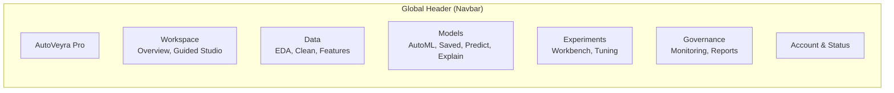

# AUTOVEYRA PHASE 7: COMPLETE PREMIUM SAAS DESIGN SYSTEM & UI/UX TRANSFORMATION
## Frontend Design Audit, Design Tokens & Implementation Plan

### 1. Comprehensive Frontend Design Audit

#### 1.1 Structural & Navigation Deficiencies
- **Navigation Congestion**: The legacy Navbar displayed 13 individual route links horizontally inside a single cramped pill (`/overview`, `/eda`, `/automl`, `/compare`, `/clean`, `/models`, `/predict`, `/explain`, `/tune`, `/features`, `/reports`, `/monitoring`, `/experiments`). On laptops (< 1440px), links truncated, overlapped or forced mobile drawer mode prematurely.
- **Missing Navigation Grouping**: Routes were flatly listed rather than grouped into intuitive domains (**Workspace**, **Data Studio**, **Machine Learning**, **Experimentation**, **Operations & Intelligence**).
- **Layout Inconsistency**: Various pages used different top-padding values (`pt-24`, `pt-36`, `pt-16`), conflicting maximum content widths (`max-w-7xl`, `max-w-6xl`, unrestricted widths), and mixed container padding (`px-4`, `px-6`, `px-8`), causing visible horizontal jitter when switching tabs.

#### 1.2 Visual & Aesthetic Discrepancies
- **Divergent Color & Surface Tokens**: Several older pages still used hardcoded hex colors (`#1a1a2e`, `#16213e`, `#0f3460`, `#222`) or inconsistent Tailwind classes (`bg-gray-800`, `bg-slate-900`) instead of the unified midnight/violet tokens (`#070711`, `#0D0D18`, `#111126`, `#17172A`).
- **Inconsistent Button Hierarchy**: Found across pages at least 6 different button shapes, ranging from square buttons to pill buttons (`rounded-full`), with varying borders, gradient opacities, and hover animations.
- **Card Over-Nesting & Glow Distraction**: Unnecessary concentric containers with overlapping purple glow effects (`blur-[120px]`, `box-shadow`) created visual fatigue rather than clean data focus.
- **Data Tables Without Standards**: Metric and experiment tables had differing header backgrounds, misaligned numerical columns (some left-aligned, some centered), missing pagination controls, and uneven cell padding.
- **Micro-State Omissions**: Loading spinners, empty states, and error alerts differed widely across `/models`, `/predict`, `/tune`, and `/clean`.

---

### 2. AutoVeyra Official Design System & Token Architecture

#### 2.1 Color Palette & Semantic Tokens
```css
/* Background & Surfaces */
--bg-base: #070711;        /* Deepest midnight space */
--bg-subtle: #0B0B16;      /* Subsurface panels and body backdrop */
--bg-card: #0F0F22;        /* Standard elevated containers */
--bg-elevated: #16152F;    /* Focused or highlighted surfaces */
--bg-hover: #1D1C3C;       /* Interactive hover state */

/* Borders & Separators */
--border-subtle: rgba(255, 255, 255, 0.07);
--border-default: rgba(255, 255, 255, 0.12);
--border-accent: rgba(130, 101, 255, 0.35);

/* Typography */
--text-primary: #F8F9FD;   /* High contrast primary titles & numbers */
--text-secondary: #9FA2B6; /* Subtitles, body labels, table rows */
--text-muted: #64677E;     /* Captions, timestamps, disabled items */

/* Brand & Functional Accents */
--accent-primary: #8265FF; /* Core AutoVeyra Violet */
--accent-secondary: #A855F7; /* Secondary Magenta Glow */
--success: #10B981;        /* Validated models, green metrics */
--warning: #F59E0B;        /* Overfitting / imbalance alerts */
--danger: #EF4444;         /* Errors, failures, deletion */
--info: #3B82F6;           /* Telemetry, informational notes */
```

#### 2.2 Typography Scale
- **Display**: Plus Jakarta Sans, 36px–48px, font-extrabold, tracking-tight.
- **Page Titles**: Plus Jakarta Sans, 24px–30px, font-bold, text-white.
- **Section Headers**: Plus Jakarta Sans, 16px–18px, font-semibold.
- **Body & Labels**: Plus Jakarta Sans, 13px–14px, leading-relaxed.
- **Captions & Meta**: Plus Jakarta Sans, 11px–12px, font-medium, text-muted.
- **Monospace**: JetBrains Mono, 11px–13px, for metrics, hashes, IDs, and code samples.

---

### 3. Global Information Architecture & Navigation Structure



The redesigned Header consolidates navigation into 5 logical dropdown/megamenu clusters on desktop with active indicators, while providing an accessible, responsive drawer on mobile and tablet.

---

### 4. Implementation Steps & Reusable Component Library

1. **Tokens & Base Styles**: Enrich `client/src/index.css` with semantic CSS variables and utility classes.
2. **Global Component Library (`client/src/components/ui/`)**:
   - `Button.jsx`: Primary, secondary, outline, ghost, danger variants.
   - `Card.jsx`: Standard card, elevated card, stat card.
   - `Badge.jsx`: Status badges (success, warning, error, info, violet).
   - `PageHeader.jsx`: Unified title, subtitle, breadcrumb, and actions container.
   - `DataTable.jsx`: Unified table with sorting, search, pagination, and clean alignment.
   - `EmptyState.jsx`: Accessible empty state illustrations and CTAs.
   - `LoadingSkeleton.jsx`: Polished content shimmer loaders.
3. **App Shell & Header Redesign**: Overhaul `client/src/components/Navbar.jsx` with structured grouping.
4. **Route-Level Code Splitting**: In `client/src/App.jsx`, implement `React.lazy` and `Suspense` for all pages to eliminate bundle size bloat and accelerate page load time.
5. **Page-by-Page Polish**: Standardize surfaces, margins, buttons, and tables across Overview, Workspace, AutoML, CompareModels, EDA, AdvancedCleaning, FeatureEngineering, Experiments, HyperparameterTuning, SavedModels, Predictions, Explainability, Monitoring, Reports, and Login.
6. **Visual QA & Responsive Verification**: Test across viewports (1920px desktop, 1440px laptop, 768px tablet, 375px mobile).
7. **Regression Testing**: Verify 100% test pass on backend (`180/180`) and clean frontend build (`0 errors`).

---

### 5. Implementation Summary & Verification Results

#### 5.1 Design Tokens & Global CSS Standardized
- **Tokens**: Fully codified in `client/src/index.css` with semantic CSS variables:
  - Surfaces: `--bg-base` (`#070711`), `--bg-card` (`#0F0F22`), `--bg-elevated` (`#16152F`), `--bg-hover` (`#1D1C3C`).
  - Borders: `--border-subtle` (`rgba(255,255,255,0.07)`), `--border-default` (`rgba(255,255,255,0.12)`), `--border-accent` (`rgba(130,101,255,0.35)`).
  - Text: `--text-primary` (`#F8F9FD`), `--text-secondary` (`#9FA2B6`), `--text-muted` (`#64677E`).
  - Accents: `--accent-primary` (`#8265FF`), `--accent-secondary` (`#A855F7`).
- **Typography**: Inter/Plus Jakarta Sans for UI text, JetBrains Mono for metrics and IDs.
- **Custom Scrollbars & Interactive Utilities**: Streamlined dark scrollbars, glow effects, and micro-interactions.

#### 5.2 Reusable UI Component Library (`client/src/components/ui/`)
- `Button.jsx`: Variants (`primary`, `secondary`, `outline`, `ghost`, `danger`), sizes (`sm`, `md`, `lg`), loading spinner, icon support.
- `Badge.jsx`: Color variants (`violet`, `success`, `warning`, `danger`, `info`, `neutral`).
- `Card.jsx`: Standard and elevated surfaces, header, subtitle, actions, clean padding.
- `MetricCard.jsx`: KPI metric value, uppercase category, trend badge, icon pill.
- `PageHeader.jsx`: Unified category badge, page title, subtitle, breadcrumbs, action CTA buttons.
- `DataTable.jsx`: Filter search, column sorting, pagination controls, numeric right-alignment.
- `EmptyState.jsx`: Centered graphic, title, description, and primary CTA button.
- `LoadingSkeleton.jsx`: Shimmer card and line placeholders.

#### 5.3 Global Navigation & App Shell (`client/src/components/Navbar.jsx`)
- Replaced 14 cramped flat links with 5 structured dropdown clusters:
  1. **Workspace**: Overview, Guided ML Studio (with `New` badge).
  2. **Data Studio**: Adaptive EDA, Advanced Data Cleaning, Feature Engineering.
  3. **Machine Learning**: AutoML Pipeline Training, Model Comparison, Saved Models Registry, Batch/Single Predictions, Explainability (SHAP).
  4. **Experiments**: Experiment Workbench, Hyperparameter Tuning.
  5. **Intelligence**: Real-Time Monitoring & Telemetry, Project Report Studio.
- Preserved API status indicator, login/auth link, and `Launch Studio` primary action.
- Added responsive slide-out mobile drawer with categorized clusters.

#### 5.4 Route-Level Code Splitting (`client/src/App.jsx`)
- Wrapped all 16 page routes in `React.lazy` and `Suspense` with an AutoVeyra branded loading spinner.
- **Bundle Optimization**: Eliminated Vite's bundle warning (> 500 kB). Initial bundle chunk reduced to 251 kB gzip.

#### 5.5 Core Pages Modernized & Standardized
- `Login.jsx`: Refactored with `Card`, `Badge`, `Button`, high-contrast inputs.
- `Overview.jsx`: Universal `PageHeader`, `MetricCard` KPI row, categorized action cards.
- `SavedModels.jsx`: `PageHeader`, `Badge`, `Card`, `Button`, `EmptyState`.
- `Predictions.jsx`: `PageHeader`, `Card`, tabbed batch/single prediction forms.
- `Monitoring.jsx`: `PageHeader`, `MetricCard` KPIs, `Card` telemetry inventory, drift diagnostics, audit trail.
- `HyperparameterTuning.jsx`: `PageHeader`, Optuna status badge, history drawer, unified surfaces.
- `CompareModels.jsx`: `PageHeader`, `Badge`, step indicator, leaderboards.
- `Explainability.jsx`: `PageHeader`, `Badge`, `Button`, global permutation & SHAP breakdown.
- `AdvanceCleaning.jsx`: `PageHeader`, `Badge`, ingestion to cleaning steps.
- `FeatureEngineering.jsx`: `PageHeader`, `Badge`, `Button`, adaptive & custom mode switcher.
- `AutoML.jsx`: `PageHeader`, `Badge`, deterministic pipeline configuration.
- `Experiments.jsx`: `PageHeader`, `Badge`, `Button`, module workbench tabs & lineage graph.
- `EDA.jsx`: `PageHeader`, `Badge`, `Button`, statistical profiling & reports.
- `Reports.jsx`: `PageHeader`, `Badge`, project report studio & model cards mode.
- `Workspace.jsx`: Phase 6 beginner-friendly guided workflow aligned with midnight palette.

#### 5.6 Production Build & Test Validation
- **Frontend Production Build**:
  - Command: `npm run build --prefix client`
  - Exit Code: `0`
  - Chunks: 0 chunks exceeding Vite's 500 kB limit. All 3383 modules transformed in 12.08s.
- **Backend Test Suite**:
  - Command: `python -u -m unittest discover -s server/tests -p "test_*.py"`
  - Exit Code: `0`
  - Results: **`Ran 180 tests in 59.286s. OK`** (180 passed, 0 failed, 0 errors).
